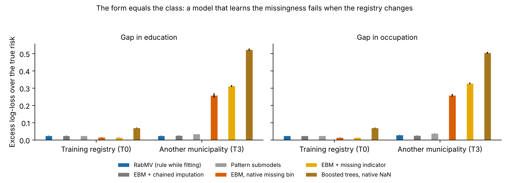

# RabMV — Registry-Aware Boosting Machine of Valledupar

*Versión en español: [README.es.md](README.es.md).*

RabMV is an explainable boosting machine (a generalized additive model fitted by cyclic Newton boosting)
that **knows the structure of the registry** its data come from: which concepts each surveillance form
measures, in which version, and how comparably. It was born in Valledupar (Colombia), where completed
suicides and suicide attempts are recorded on different forms, so that a naive model learns the form instead
of the person. The method is general: any public-health surveillance registry with forms that change over
time or differ between institutions can use it.

Version **0.1.0**. Validated in two frozen simulations and developed on a real registry (Valledupar, Colombia).
A research method: not a clinical decision tool.

- **Documentation:** <https://jannerpareja.github.io/rabmv/> (sources in [docs/](docs/index.md)): quickstart,
  schema reference, method, theory, validation, API.
- **License:** BSD-3-Clause. **Citation:** the method article is in preparation; meanwhile cite the software
  with [CITATION.cff](CITATION.cff) (GitHub shows it as «Cite this repository»).
- **Authors:** Janer Alfonso Pareja Gutiérrez (corresponding, aparejaj@uninorte.edu.co) and Margarita Rosa
  Gamarra Acosta, Universidad del Norte, Engineering School, Barranquilla, Colombia.

*Simulation v2 (synthetic data, 100 replicates, form equal to the class). In the training registry the methods
that learn the missingness look better; in another municipality, whose instrument leaves the gap in the other
class, they fail, while RabMV and chained imputation without the outcome keep their performance.*

## What it does

1. **Concept catalog** (`rabmv.schema.Catalog`, TOML): what is measured, with which type and codes.
2. **Mappings per form and version** (`rabmv.schema.Mapping`, TOML): how each field of each form translates
   to a concept, with its equivalence (`exact`, `aggregated`, `partial`), the meaning of a blank, the response
   format and the validity dates.
3. **Per-case availability** (`rabmv.harmonize`): measured, missing or not measured by the form in force.
4. **Eligibility rule** (`rabmv.evaluate_eligibility`): a concept enters the model only if it was measured
   comparably in both classes, at the finest common resolution.
5. **Estimator** (`rabmv.RabMVClassifier`, scikit-learn API): optimal piecewise Newton step by dynamic
   programming, vectorized bags, exact additive explanations. With `missing='marginalize'` a concept that the
   form did not measure contributes 0; with `categorical_features` nominal variables do not depend on how their
   categories were numbered. Pairs (`interactions`) are allowed with marginalization: each pair table is
   purified (functional ANOVA), so a pair with an unmeasured concept contributes its exact conditional average,
   0. Without these options it is bit-for-bit identical to EBMP v1.
6. **Audit checks** (`rabmv.run_checks`): detect undeclared differential measurement (A: constant in one
   class; B: single choice; C: blanks recorded as "No"; E: a year without the field). The optional
   `rabmv.drop_explained_pairs` withdraws single-choice pairs explained by an A or C alert.

Reports contain only aggregated counts (1 to 4 suppressed); no saved object contains data rows.

## Funding and acknowledgements

Supported by the Ministry of Science, Technology and Innovation of Colombia (Minciencias, Call 975 of 2026,
«Becas para el Cambio», National Doctorate) and by Universidad del Norte. We thank the Secretaría de Salud
Municipal de Valledupar, whose surveillance registry motivated the method and was used in its development; the
registry data are not distributed, and every data file in this repository is synthetic. RabMV is part of the
doctoral thesis of J. A. Pareja Gutiérrez, supervised by M. R. Gamarra Acosta. Details:
[docs/about.md](docs/about.md).

## Installation and tests

    python -m pip install rabmv

From a clone, with the tests:

    python -m pip install -e ".[dev]"
    python -m pytest

A five-step example on a public synthetic registry: `python examples/quickstart.py`
([docs/quickstart.md](docs/quickstart.md)).

The development harness (`development/`) also needs `python -m pip install -e ".[dev,development]"`.

## Repository layout

| Folder | Content |
|---|---|
| `src/rabmv/` | The method (estimator, schema, availability, eligibility, checks) |
| `tests/` | Unit, regression (against the frozen EBMP v1) and integration tests |
| `simulation/` | ADEMP simulation that validates the method where the truth is known (frozen protocol) |
| `simulation_v2/` | Second ADEMP simulation: treatment of what was not measured, transportability and audits |
| `development/` | Development runs with real data (only aggregates leave the user's machine) |
| `examples/` | Public synthetic registry with its schema, and a quickstart |
| `docs/` | Documentation and the proofs of purified marginalization |

## Simulation (phase 3)

`simulation/`: generator (assumptions declared in its docstring), calibration of the checks (seeds 1–50),
scenarios with models and evaluation (seeds 101–300). The protocol is frozen in
`simulation/FROZEN_PROTOCOL.json`: the evaluation does not run if any frozen file changes. From the
repository root:

    python -m simulation.evaluate audit
    python -m simulation.evaluate models --processes 4
    python -m simulation.evaluate summary

Result (26 Oct 2026, 180 events, 200 replicates): every pre-specified criterion met (`method_validity: true`).

## Simulation v2

`simulation_v2/` (plan in `simulation_v2/PLAN.md`) reuses the population of v1 and records it with:
- a form–class coupling π;
- a gap concept (education or occupation) with a structural, MAR or MNAR mechanism;
- five target registries: the same, a complete instrument, a form unrelated to the class, another
  municipality whose completed-suicide instrument does not measure the concept, and convergence.

It compares RabMV's marginalization with imputation, indicators, chained equations and pattern submodels on
both engines (RabMV and InterpretML's EBM), with EBM's native missing bin and with gradient-boosted trees.
It also compares RabMV's checks with the audit battery of Shukla et al. (2026) and with a missingness–class
test. It needs the `development` extra. From the repository root:

    python -m simulation_v2.calibrate                       # engine hyperparameters (seeds 1–20)
    python -m simulation_v2.run test --processes 4          # 3 seeds: errors and timing
    python -m simulation_v2.run freeze
    python -m simulation_v2.run evaluation --processes 4    # seeds 101–200; resumes where it stopped
    python -m simulation_v2.run summary --level evaluation

## Development with real data (phase 5)

`development/`: RabMV against InterpretML's EBM with the 4 balancing methods and 4 optimizers of
Competencia 1, on the comparable core of 8 concepts (window 2016–2022), in repetition 1 of the 5×5. Three
variants: EBM and RabMV with the same matrix (Competencia 1 pipeline), registry-aware RabMV (catalog and
mappings, marginalization and categorical features; only without balancing and with weights) and a
diagnostic variant (the same matrix with education in the registry's common resolution). Design version 2:
RabMV searches interactions like EBM, and class weights carry the prior correction of King and Zeng (2001)
for both models. `--balancing none weights` runs the level in blocks. `EBM_registry` (EBM with exactly the
registry-aware input) isolates how each model treats what was not measured. Running tasks print their progress
(inner fits done) every 10 minutes; `report --schema <study schema>` writes figures, equations and tables with
the English labels of `labels_en.toml`, from the saved checkpoints only. Two levels:
`test` (fold 0, 3 evaluations; detects errors and measures times) and `development` (folds 0–4, inner CV of
5, 24 evaluations). Per-case checkpoints go to a work folder outside this repository.

## Confirmation with real data (phase 6)

Pre-specified in `development/PROTOCOL_PHASE6.md` (its fingerprint is registered in `development/config.py`;
the analysis refuses a changed protocol). No balancing and Bayesian search for the five variants, in three
levels: `confirmation` (repetitions 2–5 of the 5×5, folds 5–24, which decide), `temporal` (fit 2016–2020, test
2021–2022) and `final` (search and refit on every case; out-of-fold probabilities give the threshold and an
internal validation; these are the published models). `analyze` runs the pre-specified analysis from the
checkpoints, without training: non-inferiority of RabMV against EBM (margin 0.01 of AUC-PR, corrected t-test,
weak calibration), superiority only if it holds, the secondary family with Holm, Bayesian correlated t-tests
(ROPE ±0.01), the shortcut ablation of EBM_registry (missing-value scores set to 0), supporting counts,
calibration, equity by sex, decision curve, stability of the interpretation, cost, temporal validation and
final models; it writes `decisions.json`, `RESULTS_PHASE6.md`, tables, figures and a manifest of fingerprints in
`development/results/phase6/`.

## History

- EBMP v1 (Competencia 1): explainable boosting machine written from scratch; frozen copy in
  `tests/reference/ebm_propio_v1.py` (fingerprint 0396E530B408B66A).
- Phases 1–2e (Oct 2026): package `ebmp`, registry-aware schema, availability, eligibility, marginalization,
  categorical features and audit checks.
- Phase 3 (26 Oct 2026): ADEMP simulation; method valid.
- Phase 4 (27 Oct 2026): first audit with the Valledupar schema on real data (aggregates only).
- 27 Oct 2026: renamed `ebmp` → `rabmv` (RabMV) and translated to English (code, documentation and tests).
  A change of names only: the regression test against v1 is bit-for-bit identical, and the simulation gives the same
  per-seed values and the same decisions (details in `simulation/FROZEN_PROTOCOL.json`).
- 0.1.0.dev10 (27 Oct 2026): purified interactions with marginalization (`rabmv.core.purification`);
  development design version 2 (interactions for RabMV, prior correction of the weights, diagnostic variant).
- Phase 5 (28–31 Oct 2026): development level, repetition 1 (280 tasks, 0 errors). SMOTE and ADASYN create
  values that do not exist in the data and are dropped; class weights bring no gain; EBM_registry learns a large
  score for missing education (a form shortcut), which phase 6 measures with a pre-specified ablation.
- Phase 6 (31 Oct 2026): confirmation levels, pre-specified analysis (`analyze`), report with continuous shape
  functions drawn in their original units and visible progress.
- Phase 6, plan version 2 (1 Nov 2026, `development/PLAN_PHASE6_v2.md`): estimation framing for RabMV against EBM
  (a 0.01 margin in AUC-PR cannot be resolved with 181 events) and `explore`: exploratory shortcut ablations
  (missing scores following RabMV's rule; form-exclusive categories) and the resolution of the data.
- Simulation v2 (1 Nov 2026, `simulation_v2/`): plan, code and desk test; frozen before its evaluation.
- 0.1.0 (3 Nov 2026): first public release: refinement of check B, proofs of purified marginalization, public
  synthetic example, documentation, license, citation and continuous integration ([CHANGELOG.md](CHANGELOG.md)).
