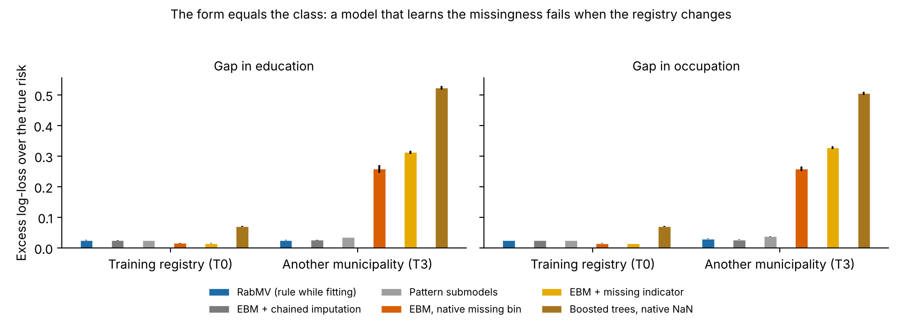

# Validation

All results on this page come from synthetic data with a known truth. The protocols were frozen before the
evaluations, and each evaluation refuses to run if a frozen file changes. The development and confirmation
with the real Valledupar registry (aggregates only) are reported in the article.

## Simulation v1 (frozen 26–27 Oct 2026; `simulation/`)

The form coincides with the class. 200 replicates per level (seeds 101–300); the checks were calibrated on
seeds 1–50 before the evaluation.

| Criterion (180 events) | Result |
|---|---|
| Sensitivity of checks A, B, C, E to undeclared differences | 1.00 (Wilson lower limits 0.981–0.990) |
| Specificity without differential measurement | 13,600 of 13,600 concept tests without alert |
| Marginalizing a concept absent in a whole registry, equivalence with retraining (±0.01 AUC-PR) | Met |
| Drop of AUC-PR when the registry changes, strict RabMV / naive model / trees | 0.001 / 0.399 / 0.386 |

## Simulation v2 (frozen 1 Nov 2026; `simulation_v2/`, plan in `simulation_v2/PLAN.md`)

**Design.**
- 12 conditions with 180 events × 100 replicates, plus 2 conditions with 60 events.
- Form–class coupling π ∈ {1, 0.85, 0.5}; a gap in education (weak effect) or occupation (strong effect).
- Structural, MAR and MNAR blanks.
- Five target registries of 10,000 events each.
- 16 methods (every missing-data strategy on both RabMV and InterpretML's EBM, plus trees with native NaN) and
  three audits (RabMV's checks, the battery of Shukla et al. 2026 and a missingness–class test).

### Pre-specified criteria

| Criterion | Result |
|---|---|
| C1 Transport: π = 1, another municipality (T3), excess log-loss of RabMV below EBM-native, indicators and trees | **Met.** 0.025–0.029 against 0.25–0.33 (EBM, indicators) and 0.50–0.52 (trees) |
| C2 No cost of the rule where blanks are made by people (MAR) | **Met.** Δ AUC-PR +0.001 to +0.002, 90 % CI inside ±0.01 |
| C3 Detection | **Met.** 200/200 detected; 1,600/1,600 concepts without false alert |
| C4 Localization: the gap concept alerted and no honest concept alerted | **Not met.** 180/200 = 0.90, Wilson lower limit 0.851 < 0.90 |

### Discrimination and calibration in the training registry and in another municipality

Form equal to the class (π = 1), 180 events, means over 100 replicates. Target registries of 10,000 events with
a prevalence of about 0.08, which is also the AUC-PR of a model at random. AUC-ROC allows comparison with the
literature; AUC-PR is informative with imbalanced classes (Saito and Rehmsmeier, 2015); the excess log-loss
over the true risk combines both with calibration.

| Gap | Method | AUC-ROC T0 | AUC-ROC T3 | AUC-PR T0 | AUC-PR T3 | Excess log-loss T0 | Excess log-loss T3 |
|---|---|---|---|---|---|---|---|
| Education | RabMV | 0.834 | 0.834 | 0.349 | 0.348 | 0.025 | 0.025 |
| | EBM + chained imputation | 0.835 | 0.832 | 0.357 | 0.348 | 0.024 | 0.025 |
| | EBM, native missing bin | 0.857 | 0.215 | 0.384 | 0.046 | 0.015 | 0.258 |
| | EBM + missing indicator | 0.858 | 0.090 | 0.386 | 0.040 | 0.014 | 0.312 |
| | Boosted trees, native NaN | 0.817 | 0.128 | 0.293 | 0.042 | 0.070 | 0.523 |
| | True risk (oracle) | 0.880 | 0.880 | 0.469 | 0.469 | 0 | 0 |
| Occupation | RabMV | 0.834 | 0.826 | 0.350 | 0.320 | 0.025 | 0.029 |
| | EBM + chained imputation | 0.834 | 0.832 | 0.355 | 0.341 | 0.025 | 0.026 |
| | EBM, native missing bin | 0.858 | 0.193 | 0.386 | 0.044 | 0.015 | 0.258 |
| | EBM + missing indicator | 0.858 | 0.070 | 0.386 | 0.040 | 0.014 | 0.327 |
| | Boosted trees, native NaN | 0.817 | 0.138 | 0.293 | 0.043 | 0.070 | 0.505 |
| | True risk (oracle) | 0.880 | 0.880 | 0.469 | 0.469 | 0 | 0 |

In the training registry the methods that learn the missingness look best. In another municipality their
AUC-ROC falls below 0.5 (their ranking is inverted, because the gap now falls in the other class), while RabMV
and chained imputation keep their performance. Without any differential measurement (`no_difference`) RabMV and
EBM have AUC-ROC 0.869 and 0.870 and AUC-PR 0.435 and 0.441 (the engine difference).

### What else the simulation showed (descriptive)

- **The shortcut is real and large.** With π = 0.85, methods that use the missingness itself (native missing
  bin, indicators, pattern submodels, trees) gain 0.29–0.34 of AUC-PR from it in the training registry.
  RabMV gains nothing.
- **The rule must be applied while fitting.** Applying it to an already fitted EBM works with π = 1 but fails
  with π = 0.85 (excess log-loss 0.083).
- **Chained-equation imputation without the outcome also avoids the shortcut** and transports as well as RabMV:
  up to 0.003 better in excess log-loss in some conditions (gap in occupation, π = 0.85), slightly worse in
  others (gap in education, T3). RabMV's distinctive value is the declared schema, the checks and the eligibility,
  with a single additive model and no imputation model.
- **The strict eligibility rule has a cost.** It gives up partially comparable concepts when the form is
  unrelated to the class (π = 0.5).
- **The prediction about MNAR blanks was not confirmed.** It was declared that EBM's native bin would beat the
  rule there, but they were almost equal: the simulated MNAR blanks carried little information.
- **Shukla et al. (2026) behaved as predicted.**
  - With the form equal to the class: FAIL in 100 % of replicates, also with a correct schema; their
    form-blocked attribution is undefined; no concept is named.
  - With a year trend of the class and no measurement difference: FAIL or CAUTION in 26 %, while RabMV's checks
    gave 0 alerts.

### Diagnosis of C4 (post hoc, declared as such: `python -m simulation_v2.posthoc_c4`)

- **Cause.** Every false alert was a check-B pair containing f6, a concept whose blanks are recorded as "No" in
  completed suicides (already alerted by C). Its partner (f7, f8 or occupation) looked single-choice through it.
- **Refinement.** `rabmv.drop_explained_pairs` withdraws B alerts explained by an A or C alert. With it,
  localization is 200/200 (Wilson lower limit 0.981) without losing any detection.
- **What remains.** With π = 0.85, 8–12 % of replicates keep a false partner of f1 or f2.
- **How it is reported.** C4 stays reported as not met; the refinement is optional and documented as post hoc.

## References

- Morris, T. P., White, I. R., and Crowther, M. J. (2019). Using simulation studies to evaluate statistical
  methods. *Statistics in Medicine*, 38(11), 2074–2102.
- Saito, T., and Rehmsmeier, M. (2015). The precision-recall plot is more informative than the ROC plot when
  evaluating binary classifiers on imbalanced datasets. *PLoS ONE*, 10(3), e0118432.
- Shukla, A., McCaslin, D. L., and Mohanty, P. (2026). Auditing measurement processes in clinical registries:
  detecting label–environment confounding before model development. *Proceedings of the Machine Learning for
  Healthcare Conference*, PMLR 340, 1834–1864.
